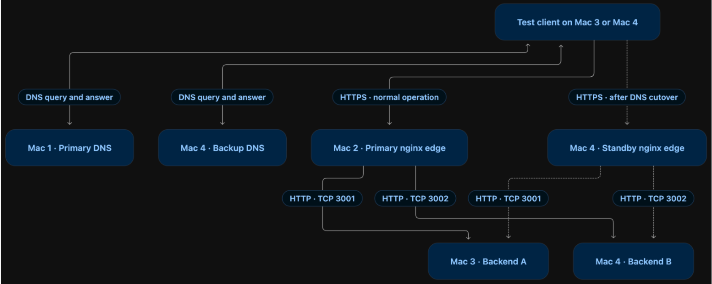

# Architecture



# team1 private network service

Run a private HTTPS service on four Macs connected to the same LAN. Clients resolve `app.team1.test` using team DNS, connect to nginx on port 8443, and receive a response from Backend A or B. The headers `X-Edge` and `X-Backend` identify the two machines involved.

Phase 1 covers private DNS, trusted HTTPS, round-robin load balancing, HTTP cache validation and packet inspection. Phase 2 adds backup DNS, backend failover, firewall isolation and controlled edge migration.

## Machines and traffic

| Folder | Role | Listening ports | Example LAN address |
|---|---|---|---|
| mac1-dns | Primary dnsmasq, firewall test client | DNS 53 UDP/TCP | 10.7.15.3 |
| mac2-edge | Primary nginx reverse proxy and load balancer | HTTPS 8443 TCP | 10.7.19.44 |
| mac3-backend-a | Python backend A, main test/capture client | HTTP 3001 TCP | 10.7.8.159 |
| mac4-backend-b | Python backend B, backup DNS, standby nginx, second test client | HTTP 3002 TCP, DNS 53 UDP/TCP, HTTPS 8443 TCP | 10.7.10.8 |

Clients ask Mac 1 or Mac 4 for the address of the edge. Normally both resolvers return Mac 2. During cutover both return Mac 4. The client opens a separate TLS connection to that edge. The edge selects a backend and forwards the request over HTTP. Both backends implement `/`, `/api/status`, and `/cache-demo`. The same DNS records also support `api.team1.test`.

## Repository setup

The repository uses one shared Makefile and four role directories. Each Mac runs Make inside its own role directory. The following layout can be initialized once from the repository root when the source tree contains `Makefile` and `backend/backend.py`:

```sh
mkdir -p mac1-dns mac2-edge mac3-backend-a mac4-backend-b
printf '1\n' > mac1-dns/ROLE
printf '2\n' > mac2-edge/ROLE
printf '3\n' > mac3-backend-a/ROLE
printf '4\n' > mac4-backend-b/ROLE
cp backend/backend.py mac3-backend-a/backend.py
cp backend/backend.py mac4-backend-b/backend.py
```

From the repo root, distribute the shared Makefile to each folder:

```sh
for dir in mac1-dns mac2-edge mac3-backend-a mac4-backend-b; do
  cp Makefile "$dir/Makefile"
done
```

### Local working directory on each Mac

From the local checkout, select the directory assigned to the machine:

| Machine | Command from repository root | Expected output of `cat ROLE` |
|---|---|---|
| Mac 1 | `cd mac1-dns` | 1 |
| Mac 2 | `cd mac2-edge` | 2 |
| Mac 3 | `cd mac3-backend-a` | 3 |
| Mac 4 | `cd mac4-backend-b` | 4 |

Each directory requires `ROLE` and `Makefile`. Macs 3 and 4 also require `backend.py`. All commands below assume this working directory, including commands in a second terminal. Runtime configuration lives in `run/`; the private key stays on the edge that generated it.

## First installation on each Mac

Use a LAN that permits connections between devices. Have administrator access and Homebrew available. Install Apple's command line tools if `make` or Git is missing (`xcode-select --install`). On Apple silicon, if Homebrew is installed but missing from PATH, run `eval "$(/opt/homebrew/bin/brew shellenv)"`. Install Wireshark on Mac 3 for inspecting captures.

```sh
command -v make brew
iface=$(route -n get default | awk '/interface:/{print $2}')
ipconfig getifaddr "$iface"
```

Use the same four current LAN addresses on every host. On each Mac:

```sh
make setup
cat run/lan
```

Enter the IPs in the same Mac 1–4 order on all four machines. Setup installs role dependencies and writes the address file. Use the physical LAN as the default route for the lab; a VPN interface can cause the startup address check to fail.

### TLS certificates and client trust

Skip certificate creation if the existing `edge-2.crt` or `edge-4.crt` and matching `run/edge.key` are present on their respective edges and clients already trust them. The Makefile reuses these files. On a fresh install, run this block **once on Mac 2 and once on Mac 4**, after setup:

```sh
role=$(cat ROLE)
( set -e
  case "$role" in 2|4) ;; *) echo "Use an edge Mac"; exit 1;; esac
  test ! -e run/edge.key && test ! -e "edge-$role.crt" || { echo "Existing TLS files; preserve the pair"; exit 1; }
  umask 077
  "$(brew --prefix openssl@3)/bin/openssl" req -x509 -newkey rsa:2048 -nodes -sha256 -days 180 \
    -keyout run/edge.key -out "edge-$role.crt" -subj "/CN=app.team1.test" \
    -addext "subjectAltName=DNS:app.team1.test,DNS:api.team1.test" \
    -addext "extendedKeyUsage=serverAuth"
  shasum -a 256 "edge-$role.crt"
)
```

Transfer **only the two public certificates** to the role folders on both test clients (Macs 3 and 4). Compare their fingerprints with the respective edge Macs. On each test client, trust both certificates:

```sh
shasum -a 256 edge-2.crt edge-4.crt
sudo security add-trusted-cert -d -r trustRoot -p ssl -k /Library/Keychains/System.keychain edge-2.crt
sudo security add-trusted-cert -d -r trustRoot -p ssl -k /Library/Keychains/System.keychain edge-4.crt
```

## Start and verify

1. On **every Mac**, run `make start`. This starts its local services in the background, configures project-domain resolution on Macs 3 and 4, and records an inventory. Use `make status` to inspect listeners. Keep both nginx services running during verification.
2. Once all four are ready, run `make inventory` on each. Confirm peer ping results. Use the saved interface, MAC address, mask and gateway to complete the team's IP/service inventory.
3. On **Mac 3**, run the following and compare the output before running fault tests:

```sh
make lookup
make https
make balance
make test
```

Both resolvers should return Mac 2's IP. HTTPS should validate normally and return HTTP 200 with `X-Edge: Mac2`. The balance test should show A and B. The test transcript includes cache headers and a conditional HTTP 304. Run `make test` on Mac 4 too for second-client evidence. A completed command alone does not establish that its output met the pass condition.

## Phase 1 · Packet flow and service behavior

On Mac 3, open two role-folder tabs. In tab 1 run `make capture`. In tab 2 run `make flush`, then `make https`. Stop only the capture with Control-C. Open the new `evidence/flow-*.pcap` in Wireshark.

| Filter | Annotate |
|---|---|
| `dns` | Client query, resolver response, edge IP, UDP source/destination ports |
| `tcp.port == 8443` | One connection's SYN, SYN-ACK, ACK, ports and sequence/acknowledgement numbers |
| `tls` | ClientHello, ServerHello, certificate and encrypted records. Use Decode As TLS for port 8443 if necessary. |

Keep the original capture, three labeled screenshots and the corresponding curl transcript. DNS TTL controls address caching. The HTTP ETag and 304 concern content caching.

### HTTP cache validation

On Mac 3, the first GET returns the resource and its validator. The second GET supplies that validator and should return HTTP 304 with no response body.

```sh
url=https://app.team1.test:8443/cache-demo
/usr/bin/curl --noproxy '*' -i "$url"
/usr/bin/curl --noproxy '*' -i -H 'If-None-Match: "team1-cache-v1"' "$url"
```

### Controlled failure checks

Each row starts with healthy services. Restore the listed configuration before the next test.

| Fault | Demonstrate | Restore |
|---|---|---|
| Wrong client DNS | Mac 3: `make client-wrong`, `make https`, `make inventory`. Lookup fails; ping still works. | `make client-two` on Mac 3 |
| Wrong record | Mac 3: `make client-one`. Mac 1: `make dns-wrong`. Mac 3: `make flush`, `make lookup`, `make https`. Observe Mac 1 answering with the wrong IP. | Mac 1: `make dns-primary`; Mac 3: `make client-two` |
| One backend down | Mac 3: `make backend-stop`, then `make balance`; expect B only. | Mac 3: `make backend-start`, wait six seconds, then `make balance`. |
| Both down | Macs 3 and 4: `make backend-stop`. Mac 3: `make https`; look for 502. | Both: `make backend-start`; wait six seconds, verify `make balance` on Mac 3. |
| Wrong port | Mac 3: `make wrong-port`, then `make https`. | Confirm the correct port returns 200. |

## Phase 2 · Resilience and recovery

Each target writes a dated transcript under that Mac's `evidence/`. Run commands in each row in order and restore the stated baseline before proceeding. A terminal error during an intentional failure is evidence; successful recovery is a separate observation.

| Scenario | Actions, by Mac | Evidence / pass condition |
|---|---|---|
| Backend HA | Mac 3: `make balance`, `make backend-stop`, `make balance`, `make backend-start`, `sleep 6`, `make balance`. | A/B → successful B-only requests → A/B. |
| Backup DNS | Mac 3: start `make capture` in a second tab. Mac 1: `make dns-stop`. Mac 3: `make flush`, then `make https`. End capture. Mac 1: `make dns-primary`. | HTTPS succeeds with a cold client cache. Capture shows a DNS response from Mac 4 returning Mac 2's address. |
| Isolation and rollback | Mac 1: `make probe`. Macs 3 **and** 4: `make isolate`. Macs 1 **and** 2: `make probe`. Mac 3: `make https`. Macs 3 and 4: `make restore`. Mac 1: `make probe`. | Before/after rollback, Mac 1 reaches both ports. During isolation, both fail from Mac 1 and succeed from Mac 2; HTTPS succeeds. Inspect both probe results. |
| TTL and edge migration | Follow the timed sequence below, with PF rollback complete. | Both DNS records change, a primed client exhibits TTL behavior, a flushed client switches, and normal HTTPS reaches the standby and returns to primary. |
| Troubleshooting | Mac 3: `make diagnose` when healthy and again while a fault is present. On the active edge inspect `tail -n 20 run/error.log`. | Identify first failing layer, hypothesis, distinguishing test, correction and retest. |

### Timed migration

1. Mac 3: validate the standby before changing DNS with `source run/lan` then `/usr/bin/curl --noproxy '*' --resolve "app.team1.test:8443:$M4" -I https://app.team1.test:8443/`. Expect Mac4. This override is for preflight only.
2. Mac 4: `make flush`, then `make https` to prime its cache. Mac 3: `make watch`. Once Mac 3 prints Mac2, signal both DNS operators.
3. Macs 1 and 4: each run `make dns-standby`. Mac 4: `make lookup`, `make flush`, `make https`. The two DNS answers should show the standby IP and TTL 30. The flushed client should reach Mac4.
4. Let Mac 3's watch finish without flushing it. Save the timed change from Mac2 to Mac4. If the old cached answer was missed, repeat during return. The number 30 in a DNS response establishes the configured TTL; timed client observations establish the cache effect.
5. Macs 1 and 4: each run `make dns-primary`. After expiry, Mac 3: `make lookup`, `make https`. Expect both answers to match Mac 2 and HTTPS to show Mac2.

## If a check fails

| Symptom | First check / next action |
|---|---|
| Missing ROLE, run/lan, or Make target | Check `pwd`, `cat ROLE` and the role Makefile. Run `make setup` for a new role folder. |
| Address already in use | Use `sudo lsof -nP -iUDP:53` or `sudo lsof -nP -iTCP:8443 -sTCP:LISTEN`. Inspect the **current** PID with `ps -ww -p PID -o command=`. If an earlier foreground project service owns it, stop that service in its original tab, then use `make start`. Start failure tests with Make-managed services so their PID files exist. |
| DNS servers disagree | `make lookup` checks each server. Restore the intended mode on the stale resolver, then check the client cache. Preserve the cache during TTL observation. |
| TCP connection fails | `make status` on the target edge; confirm nginx listens on 8443 and both peers have LAN connectivity. |
| TLS validation fails | Verify domain, active edge, certificate dates, matching edge files and that client's trust for that edge certificate. |
| HTTP 502 | Test the two backend ports from the active edge, read nginx's error log, and check backend logs in `run/backend.log`. |
| Existing scoped resolver prevents startup | Inspect `/etc/resolver/team1.test`. Preserve an existing user-managed file. Reuse the original project folder if it owns that configuration, or manually reconcile the resolver with your network administrator. |

## Local diagnostic files

Make targets save timestamped terminal output in the role's `evidence/` directory. Packet captures use `flow-*.pcap`. The active edge writes nginx errors to `run/error.log`; the Python service writes startup and request output to `run/backend.log`. Use the timestamp and hostname to correlate a client failure with the corresponding server event.
